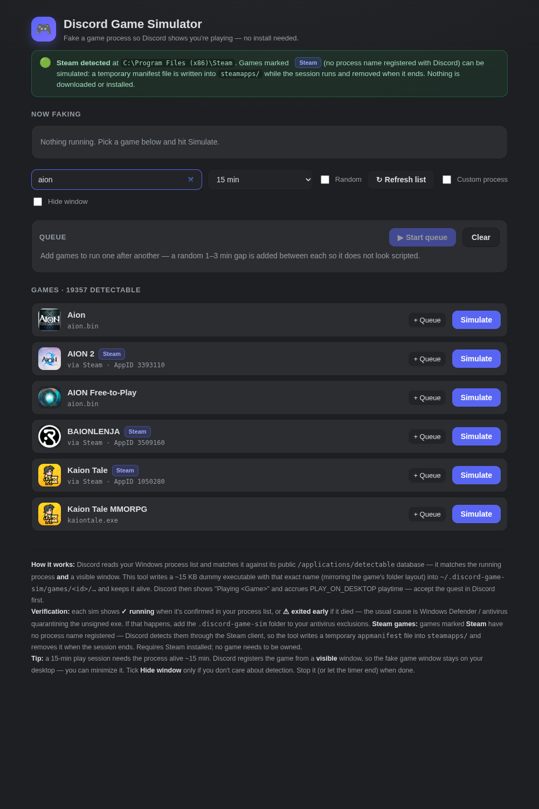
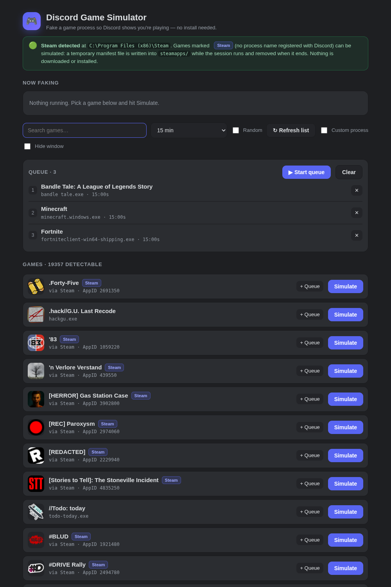

# Discord Game Simulator

Simulate a game running on your PC so Discord shows "Playing \<Game\>" — without owning (or even installing) the game.

A common use is letting **Discord's play-quests** tick up without actually playing. That use is entirely at **your own risk** (see [Disclaimer](#-disclaimer--responsible-use)) — the author is not responsible for how you use this tool.

Discord's desktop activity works by watching your **Windows process list** and matching it against its public [`/applications/detectable`](https://discord.com/api/applications/detectable) database. This tool exploits that: it writes a tiny dummy executable with the exact name (and folder layout) Discord expects for a given game, keeps it alive, and Discord does the rest — showing **"Playing \<Game\>"** and accruing real `PLAY_ON_DESKTOP` quest time.

Single file. No dependencies. No build step.

| | |
|---|---|
| **Requirements** | Windows · Discord desktop client |
| **Node.js** | Not needed if you use the prebuilt `.exe` (optional if you run from source) |
| **Dependencies** | None — one self-contained `discord-game-simulator.js` |

<p align="center">
  <br>
  <em>Live game list, duration + random range, and the queue.</em>
</p>

---

## Quick start

**Option A — prebuilt executable (recommended)**

1. Grab `dist/DiscordGameSimulator.exe`.
2. Double-click it. A console window appears and your browser opens the UI at `http://127.0.0.1:8787`.
3. That console window is the "keep it alive" handle — **closing it stops the simulator.**

> **SmartScreen** will likely flag the exe (it's unsigned). Click **More info → Run anyway**.

**Option B — from source**

```bash
node discord-game-simulator.js
```

Then open `http://127.0.0.1:8787`.

---

## Features

- **Live game list** — pulled from Discord's own `/applications/detectable` endpoint (10,000+ titles). It's the same list Discord's client uses, so it's always in sync. New games appear automatically on each launch; a small offline fallback keeps the UI usable without a connection.
- **Steam-detected games** — some titles (~8,900, e.g. AION 2) register **no process name** with Discord; Discord detects them through the local Steam client instead. The app shows them with a **Steam** badge and, when Steam is installed, simulates them — handling both cases (see [How it works](#how-it-works)): if the game is **installed**, a dummy process runs from its real install folder; if it is **not**, a temporary `appmanifest_<appid>.acf` (the file Steam creates while a download is in progress) is written into `steamapps/` and the dummy runs from `steamapps/common/<game>/`. Nothing is downloaded or installed — no game needs to be owned. Everything the app writes is removed when the session ends.
- **One-click simulate** — pick a game, set a duration, hit **Simulate**.
- **Random duration range** — tick **Random** and set a *from / to* range (in minutes). Each run picks a random duration within it, so no two sessions are identical.
- **Queue** — line up several games with the **+ Queue** buttons, then **Start queue**. They run one after another with a **random 1–3 minute gap** between each launch (the first game starts immediately). The whole thing is built to look like a human playing several games in a row.
- **Custom process** — simulate any exe name / folder, even for titles not in the detectable list.
- **Live verification** — each sim shows **✓ running** (confirmed present in your process list) or **⚠ exited early (code N)** (it died — usually antivirus).
- **Stale-server guard** — if the page is newer than the running server (a common source of confusing "not found" errors), a red banner tells you to restart the instance.

<p align="center">
  <br>
  <em>The queue with a random gap counting down between games.</em>
</p>

---

## How it works

1. `GET https://discord.com/api/applications/detectable` → every game Discord can auto-detect, with its real executable name and folder path.
2. The app writes an embedded ~15 KB GUI `.exe` (a visible window titled with the game name + an idle message loop) to
   `~/.discord-game-sim/games/<id>/<folder>/<exe>` — mirroring the game's real folder layout — and spawns it.
3. Discord sees a matching **process** *and* a **visible window**, registers the game, and its own client fires the quest heartbeats.

**Steam-detected games** (no process name registered) have two paths, chosen automatically by checking the `appmanifest_<appid>.acf` files across all your Steam libraries:

- **Game is installed** (real manifest with `StateFlags` bit 4): Discord cross-checks the registered install path, so a fake manifest in another library is ignored. The app writes a dummy named `<exe>_sim.exe` **next to the real binary** (never overwriting it) and runs it from there.
- **Game is not installed anywhere**: the app writes a fake manifest into the main library (`StateFlags 1026` = "downloading", with realistic size/progress values) and runs a dummy named exactly like the real exe from `steamapps/common/<game>/` in that same library.

Game metadata (install dir, exe path) comes from Steam's public APIs — no key or credentials required. All of this is verified on a real machine: in both cases the quest ring progresses, and everything the app writes (dummy, fake manifest, created folders) is removed when the session ends.

Because a real process with the right name and a real window exist, Discord's own client does the reporting — nothing is forged at the API layer.

### Anti-detection measures

The goal is to make a session look like a human playing several games in a row, not a bot firing identical runs back-to-back. Two mechanisms do that:

- **Random gap between queued games** — when running a queue, each launch is preceded by a **random 1–3 minute wait** (drawn independently each time). The **first game starts immediately** — no artificial delay before it. So a queue of 3 games produces a timeline like:
  `Game A (23m) → 2m07s pause → Game B (17m) → 1m33s pause → Game C (28m)`
- **Random duration per game** — tick **Random** and set a *from / to* range (in minutes); **every game picks its own duration** within that range at queue start. Combined with the random gaps, no two runs in a session share the same shape, so there's no repeating pattern to fingerprint.

What is *not* randomized (kept deterministic on purpose): the gap range itself (1–3 min, fixed in code), the order of games (exactly the order of your queue), and the absence of a trailing pause at the end of the session.

### Why the window stays visible

Discord's Windows detection registers a game from a **visible top-level window** whose owning process matches the detectable list. A fully hidden process never registers. The fake window is therefore kept on your desktop by design — **minimize it** and leave it be. Only tick **Hide window** if you don't care about detection.

---

## Usage

1. **Accept the quest** in Discord (Quest Bar / Discover → Quests). This is on you — the tool can't and shouldn't.
2. Pick a game, set a duration (or a random range), hit **Simulate** (or build a queue and **Start queue**).
3. Leave the fake process alive for the required time (e.g. 15 min for a 15-min quest).
4. **Claim the reward** when the quest flips to complete.

---

## Troubleshooting

**"⚠ exited early" under a game**
The dummy exe was killed after launching — almost always **Windows Defender / antivirus quarantining the unsigned exe**. Add the folder to your exclusions:
Windows Security → Virus & threat protection → Manage settings → **Exclusions** → Add a folder → the `~/.discord-game-sim` folder. Then re-run.

**Discord shows "Playing" but the quest doesn't progress**
- Make sure **Activity Privacy** → *Share detected activities with others* is **on** for the logged-in account.
- Wait ~10–15 seconds after launching before checking — Discord polls the process list on an interval.

**A Steam game (badge "Steam") is greyed out**
The app couldn't find Steam. Install it (or start it once so the registry entry exists) and refresh the page. The green **Steam detected** box at the top of the page shows where Steam was found — a Steam game only needs Steam to be installed, not the game itself.

**A "not found" error on an action (e.g. queue Stop)**
You're likely talking to a **stale server** — an instance started before the code on disk. A running Node server only loads its routes at startup. Stop the running instance (Ctrl+C in its console, or end it in Task Manager) and start it again. The red **Stale server detected** banner appears automatically in this case.

**Double-clicking the `.exe` shows a window that does nothing**
The port is already in use because a previous instance is still running. The app now opens the existing instance in your browser and closes the second window — but if you still see a stuck console, end the old `DiscordGameSimulator.exe` in Task Manager first.

**Orphan process left in Task Manager**
Stopping a sim (or the queue) force-kills the process tree via `taskkill /F /T`. If you ever see a leftover, the dummy exe also exits itself when its window is closed.

---

## Quest compatibility

- **Playtime-based quests** ✅ — the core use case: the fake session accrues real playtime toward `PLAY_ON_DESKTOP`-type quests (e.g. "play for 15 minutes"). Works for both process-detected games **and** Steam-detected games (see above).
- **Stream quests** ❌ — require a real Go Live with a second person in the voice channel.
- **Achievement / in-game-action quests** ❌ — those need the game's own completion data, out of scope.

---

## Project structure

```
discord-game-simulator/
├── discord-game-simulator.js   # the entire app (server + inlined UI + inlined dummy exe)
├── dist/
│   └── DiscordGameSimulator.exe  # standalone Windows build (Node runtime embedded)
└── preview/
    ├── main.png
    └── queue-ui.png
```

The HTML UI and the dummy `.exe` are inlined into `discord-game-simulator.js` as string constants, so the app is genuinely a single file. The `.exe` is built from that same file with `pkg` (Node SEA), embedding the Node runtime so the target machine needs nothing installed.

---

## Environment

| Variable | Default | Description |
|---|---|---|
| `PORT` | `8787` | Port for the local UI server |
| `HOST` | `127.0.0.1` | Bind address (localhost only) |

The server binds to `127.0.0.1` by default and only serves on your own machine.

---

## ⚠️ Disclaimer & responsible use

This tool automates the **completion of Discord's play-quests** by faking game activity. It does **not** touch your account's API layer, and Discord's own client performs the heartbeats — which is why it's the least invasive approach available.

That said, quest automation is a gray area:

- It is **against Discord's Terms of Service** in spirit (automating / falsifying activity). Use it on your own account, at your own risk.
- Discord has been **tightening enforcement** on quest automation. The risk is low but not zero — prefer small, realistic durations over farming dozens of quests at once.
- This project is for **educational purposes** (how Discord's game detection works) and personal use.

### No liability

The author provides this software **as-is, without any warranty of any kind**, express or implied. **You are solely responsible** for how you use it. The author is **not liable, in any way**, for the consequences of its use, including but not limited to:

- Account **suspension or termination** by Discord
- Loss of rewards, badges, or any account data
- Any damage to your system, or to any third party

By using this tool, you accept all associated risks.

---

## License

MIT — do whatever you want with it, no warranty of any kind.
